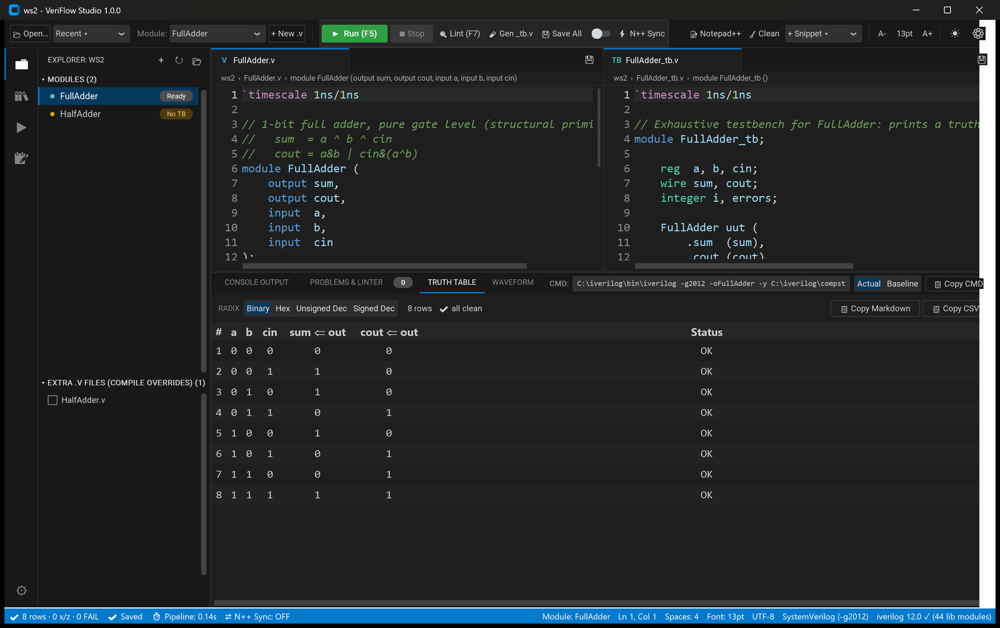

<a id="top"></a>

[🇬🇧 English](#english-documentation) | [🇮🇱 עברית (Hebrew Documentation)](#תיעוד-מלא-בעברית)

# VeriFlow Studio — VS Code-Styled Icarus Verilog IDE & One-Click Runner


-8A2BE2)




---

<a id="english-documentation"></a>

## English Documentation

### Table of contents

1. [Overview & motivation](#overview--motivation)
2. [Features](#features)
3. [Installation & quick start](#installation--quick-start)
4. [Step-by-step usage guide](#step-by-step-usage-guide)
5. [Settings reference](#settings-reference)
6. [Keyboard shortcuts](#keyboard-shortcuts)
7. [Architecture & file structure](#architecture--file-structure)
8. [Troubleshooting](#troubleshooting)
9. [License](#license)

### Overview & motivation

In a university **Computer Structure** course, every lab and homework assignment follows the same ritual: write a
gate-level module `<Module>.v`, write a testbench `<Module>_tb.v`, then type two long commands into `cmd.exe` —
again and again, for every single change:

```bat
C:\iverilog\bin\iverilog -g2012 -oFullAdder -y "C:\iverilog\compstruct\lib" FullAdder.v FullAdder_tb.v
C:\iverilog\bin\vvp FullAdder
```

Then you scroll through raw `$monitor` text to find the one row that is wrong, guess which of your wires is floating at
`z`, and wonder why a lecturer module "cannot be found" when the file is right there.

**VeriFlow Studio** replaces that loop with a fast native desktop environment that looks and feels like VS Code:

* **One click (or `F5`)** saves, lints, compiles with `iverilog`, simulates with `vvp`, and fills four result views.
* **Live two-way Notepad++ sync** – keep coding in Notepad++; every `Ctrl+S` there re-runs the whole pipeline.
* **A course-aware linter** catches the silent bugs `iverilog` happily accepts (implicit wires, port mismatches,
  file/module name mismatches that break `-y`).
* **Automatic truth tables and waveforms** straight from your testbench output and `.vcd` dump.

### Features

#### ▶ One-click atomic pipeline (`F5` / `▶ Run`)

Every run performs, in order:

1. **Auto-save** of modified editor buffers (configurable).
2. **Static course linter** on both files (results go to *Problems & Linter*).
3. **Stale-binary removal** – the previous `<WorkDir>\<Module>` image is deleted first, so a failed compile can never
   silently execute an old binary.
4. **Compilation** – `iverilog -g2012 -o<Module> -y <lecturer lib> -y <workspace> -Wall -Winfloop <Module>.v <Module>_tb.v [extra files]`.
   Both `-y` paths are added automatically, so your own sub-modules (e.g. `HalfAdder.v`) and the lecturer's modules are
   found without listing them. Success requires exit code `0`, no error lines, **and** a freshly written output file.
5. **Simulation** – `vvp -n <Module>`. The `-n` flag turns `$stop` into `$finish`, so a testbench can never hang
   waiting for interactive input. A configurable **timeout** (default 3 s) kills the whole process tree
   (`taskkill /F /T`) if the testbench has no `$finish` or contains a zero-delay infinite loop.
6. **Results** – Console, Problems & Linter, Truth Table and Waveform are all refreshed. The status bar turns **orange**
   while running, **red** on a compile error or timeout, and back to **blue** when done.

Compiler output is parsed with a Windows-safe regex that understands drive letters and column numbers
(`C:\iverilog\compstruct\lib\mux.v:14: syntax error`, `FullAdder.v:9:12: error: …`), plus fatal lines such as
`I give up.` and `No top level modules`.

#### ✍ Dual workflow — built-in editor **or** live Notepad++ sync

**Built-in editor.** Design (`.v`) and testbench (`_tb.v`) open side by side (or as tabs) with:

* VS Code **Dark+ / Light+** syntax colours for Verilog/SystemVerilog (keywords, net types, gate primitives,
  system tasks, numbers, strings, comments).
* Line-number gutter with the current line highlighted, error (red) and warning (amber) markers with hover tooltips.
* VS Code-style editor tabs with a dirty dot (`●`) and a breadcrumb bar:
  `sample_project › FullAdder.v › module FullAdder (output sum, output cout, input a, input b, input cin)`.
* Smart editing: auto-indent, auto-close `() [] {} ""`, `begin` + `Enter` inserts the matching `end`,
  Tab/Shift+Tab block indent, toggle comments, duplicate line, inline Find & Replace, Go to Line.
* Snippets (`+ Snippet ▾` or right-click → *Insert Snippet*): `module … endmodule`, `initial begin … end`,
  `always @(*)`, `$monitor`, `$display`, `$dumpfile/$dumpvars`, an exhaustive `for` loop and every gate primitive.
* Keyboard shortcuts also work with a **Hebrew keyboard layout** (they are matched by physical key).

**⚡ Live Notepad++ Sync.** Turn on the `⚡ N++ Sync` switch and VeriFlow polls the active `.v` / `_tb.v` files every
**800 ms** (configurable 500–3000 ms). When you press `Ctrl+S` in Notepad++, VeriFlow reloads the code, re-lints,
compiles, simulates and updates the truth table and waveform — no clicks needed. If you also have unsaved edits inside
VeriFlow, it refuses to overwrite them and warns you instead.

* `📝 Notepad++` opens both files of the active module in Notepad++ and switches Live Sync on automatically.
* Clicking a problem that lives in a file not open in the editors (for example a lecturer library file) opens it in
  Notepad++ **at the exact line** (`notepad++ -n<line> <file>`).

#### 📁 Workspace explorer & 📚 lecturer library inspector

* The **Explorer** pairs every `<Module>.v` with `<Module>_tb.v` automatically: a green dot + `Ready` badge when the
  testbench exists, an amber dot + `No TB` badge when it is missing.
* **Extra .v files (compile overrides)** lets you tick additional files to pass to `iverilog` explicitly (normally not
  needed thanks to `-y`).
* The **Library** view lists every module in `C:\iverilog\compstruct\lib` (44 modules in the standard course library)
  with a live filter box (type `mux`, `adder`, `xor`…). Selecting a module shows its parameters and exact port
  signature, and two buttons paste ready-made wiring:
  `📋 Copy Instantiation` and `⤵ Insert at Cursor`, e.g.

  ```verilog
  mux #(.SEL(1)) u1 (
      .out (out),
      .in  (in),
      .s   (s)
  );
  ```

#### 🧪 One-click testbench (`_tb.v`) generator

`🧪 Gen _tb.v` parses the design (ANSI and non-ANSI ports, comma lists such as `input [3:0] a, b, c;`,
parameterised headers like `module Mux #(parameter W=16)`, multi-bit buses `[msb:lsb]`) and writes a complete
`<Module>_tb.v`:

* `reg` for every input, `wire` for every output (bus ranges preserved), `<Module> uut (.port(port), …)`.
* `$dumpfile("<Module>.vcd"); $dumpvars(0, <Module>_tb);`, a header line, and `$monitor` printing
  `a=%b | b=%b | … | y=%b`.
* **N ≤ 7 input bits:** an exhaustive loop `for (i = 0; i < (1 << N); i = i + 1) begin {in1, in2, …} = i; #10; end`.
* **N > 7 input bits:** 8 structured corner-case vectors (all zeros, all ones, `1010…`/`0101…` patterns,
  carry chain `max + 1`, MSB-only overflow, mixed, pseudo-random).
* A `clk`/`clock` input gets its own `always #5` clock instead of being enumerated.
* Designs built from **lecturer modules** (which have `#5` gate delays) automatically use a longer step (`#100`) and
  sample outputs with `$display` after each step, so the truth table shows settled values instead of glitches.
* Ends with `#… $finish;`.

#### 🔎 Pre-compile course linter & diagnostics

The linter runs before every compile (and while you type). It catches bugs that a plain compiler accepts silently:

| Check | Why it matters |
|---|---|
| **Implicit undeclared wires** in gate primitives and module connections | A typo such as `and g1(y, a, bb);` creates an implicit 1-bit wire that floats at `z`. |
| **Port count / port name / port width mismatches** against workspace and lecturer modules | Wrong positional order or `.q()` on a module that has no `q` port. |
| **Unknown module / wrong letter case** (`halfadder` vs `HalfAdder`) | Verilog names are case-sensitive; `iverilog -y` will report the module as missing. |
| **File name ≠ module name** | `-y` finds module `Mux4` only in a file called `Mux4.v`. |
| **Gate arity**, missing `endmodule`, ports listed but never declared | Classic structural mistakes. |
| **Testbench hygiene** – no `$finish`, no `$monitor`/`$display`, no `$dumpfile` | Prevents timeouts and empty results. |
| **Strict gate-level mode** (optional) | Warns about `always`, `initial`, `assign`, `+`, `-`, `? :` inside design files when an assignment allows only structural gates / lecturer modules. |

Every linter finding and every `iverilog`/`vvp` error appears in **Problems & Linter** (with a count badge). Clicking a
row jumps to the file and line, which is highlighted in red (error) or amber (warning) in the editor.

#### 📊 Interactive truth table & radix converter

* `$monitor` / `$display` output is parsed automatically – both `key=value` style (`a=0 | b=1 | s=1`) and plain
  tabular output with a header row. `VCD info:` and `$finish called at …` lines are ignored.
* Rows whose outputs contain `x` or `z` are tagged **FLOATING/CONFLICT (x/z)** (orange); rows containing `FAIL`,
  `ERROR` or `MISMATCH` are tagged **FAIL** (red).
* Switch the radix live: **Binary / Hex / Unsigned Dec / Signed Dec** (two's complement uses each port's real width).
* `📋 Copy Markdown` / `📋 Copy CSV` – paste the table straight into a homework report.

#### 〰 Built-in waveform viewer & GTKWave integration

* Pure-Python `.vcd` reader (multi-character identifier codes, scalar and vector values, `x`/`z`).
* Canvas rendering: green high/low lines, hexagonal bus envelopes with the value printed in the current radix,
  red hatched blocks for `x`, yellow mid-lines for `z`, a time axis, zoom in/out, fit, and a click-to-place cursor that
  shows every signal's value at that time.
* Shows testbench-level signals by default; tick **Internal signals** to include signals inside `uut`.
* No `.vcd`? The waveform is synthesized from the truth-table rows instead.
* `📈 Open in GTKWave` opens the same dump in GTKWave.

#### 🧹 Homework submission cleaner

`🧹 Clean` deletes compiled `vvp` images from the workspace before you zip an assignment. Because they have no file
extension, they are recognized safely by their header (`#! … vvp`) – your `.v` files are never touched. `.vcd`
dumps are left in place (delete them manually if your course asks you to).

#### 🧩 Demo mode (no Icarus Verilog installed)

If `iverilog.exe` is not found, an amber banner appears and VeriFlow switches to a **built-in Python gate-level
simulator** (1-bit designs made of `and/or/nand/nor/xor/xnor/not/buf` primitives and simple `assign`s), so the editor,
linter, truth table and waveform can be explored on any machine. Lecturer modules and buses need the real toolchain.

### Installation & quick start

#### Prerequisites

1. **Icarus Verilog** installed at `C:\iverilog` (`C:\iverilog\bin\iverilog.exe`, `C:\iverilog\bin\vvp.exe`) and the
   lecturer library at `C:\iverilog\compstruct\lib`. Other locations can be set in **⚙ Settings → Compiler &
   Toolchain** (there is an **Auto-Detect Paths** button). Without Icarus Verilog the app runs in demo mode.
2. **Python 3.11+** – only if you run from source.
3. *(Optional)* **Notepad++** for Live Sync and **GTKWave** for the external waveform viewer.

#### Option A — run from source

```bash
git clone https://github.com/<your-username>/veriflow-studio.git
cd veriflow-studio
pip install -r requirements.txt
python main.py
```

You can also pass a folder to open: `python main.py "D:\CompStruct\HW3"`.

#### Option B — build a standalone Windows `.exe` (no Python needed to run it)

Double-click **`build_exe.bat`**. It installs the requirements, checks the sources, and runs PyInstaller:

```bat
python -m PyInstaller --noconfirm --clean --onefile --windowed --name VeriFlowStudio ^
    --collect-data customtkinter --hidden-import pygments.lexers.hdl ^
    --add-data "sample_project;sample_project" main.py
```

The result is a single portable file, **`dist\VeriFlowStudio.exe`** (~32 MB). Pin it to the taskbar or share it with
classmates. On first launch the bundled demo is copied to `Documents\VeriFlow Studio\sample_project` and opened.

### Step-by-step usage guide

1. **Open an assignment folder** – `📂 Open…` (or `Ctrl+O`), or pick one from `Recent ▾`. The Explorer lists every
   module and whether its testbench exists.
2. **Select or create a module** – click it in the Explorer or use the `Module:` dropdown. `+ New .v` (`Ctrl+N`)
   creates `<Name>.v` from a template (the file name always equals the module name, as `-y` requires).
3. **Use lecturer modules** – open the **📚 Library** view, filter, select a module, then `⤵ Insert at Cursor`.
4. **Create the testbench** – `🧪 Gen _tb.v` (also offered in the testbench tab when it is missing), then adjust it.
5. **Run** – press `F5`. Or click `📝 Notepad++`, code there, and just press `Ctrl+S` – Live Sync runs everything.
6. **Inspect the results** –
   * **Console Output** – the exact commands, raw `iverilog`/`vvp` output, colour-coded.
   * **Problems & Linter** – click a row to jump to the line.
   * **Truth Table** – change radix, copy as Markdown/CSV.
   * **Waveform** – zoom, place the cursor, or open GTKWave.
   * The panel header shows the command line; switch **Actual / Baseline** to see the exact command from the course
     instructions, and `📋 Copy CMD` to paste it into `cmd.exe`. The **▶ Run & Compile** view lists all flags.
7. **Before submitting** – `🧹 Clean` removes compiled binaries.

### Settings reference

Open **⚙** (top right, activity bar, or `Ctrl+,`). Every change applies **immediately** and is saved to
`%APPDATA%\VeriFlowStudio\config.json`.

| Tab | Setting | `config.json` key | Values / default |
|---|---|---|---|
| Appearance & Font | Appearance mode | `appearance_mode` | `Dark` (default), `Light`, `System` – also the ☀/🌙 button |
| | UI accent theme | `color_theme` | `blue`, `green`, `dark-blue` (applies after restart) |
| | Editor colour scheme | `editor_color_scheme` | `Dark Modern` (VS Code Dark+, default), `Light Modern` (VS Code Light+), `One Dark`, `Monokai`, `GitHub Light`, `High Contrast` |
| | UI scaling | `ui_scale_percent` | `80` `90` `100` `110` `125` `150` % |
| | Editor font family | `editor_font_family` | `Consolas`, `Cascadia Code`, `JetBrains Mono`, `Courier New`, `Lucida Console` |
| | Editor font size | `editor_font_size` | 8–28 pt (default 13) – also `A-` / `A+`, `Ctrl+wheel` |
| | Console / table font size | `console_font_size` | 8–24 pt (default 12) |
| | Default radix | `default_radix` | `Binary`, `Hex`, `Unsigned Dec`, `Signed Dec` |
| Editor Behavior | Editor layout | `editor_split_layout` | `Side-by-Side` (.v + _tb.v, default) or `Tabbed` |
| | Tab size | `tab_size` | 2, 4 (default), 8 |
| | Insert spaces for Tab | `insert_spaces_for_tabs` | on |
| | Word wrap | `word_wrap` | off |
| | Highlight current line | `highlight_current_line` | on |
| | Auto-indent | `auto_indent` | on |
| | Auto-close brackets & `begin`/`end` | `auto_close_brackets_and_blocks` | on |
| | Auto-save before Run (F5) | `auto_save_before_run` | on |
| | Auto-save on focus loss | `auto_save_on_focus_loss` | off |
| Compiler & Toolchain | iverilog.exe / vvp.exe / gtkwave.exe | `iverilog_path`, `vvp_path`, `gtkwave_path` | `C:\iverilog\bin\…`, `C:\iverilog\gtkwave\bin\gtkwave.exe` |
| | Lecturer library (`-y`) | `lib_dir` | `C:\iverilog\compstruct\lib` |
| | notepad++.exe | `notepad_pp_path` | `C:\Program Files\Notepad++\notepad++.exe` |
| | Verilog generation flag | `std_flag` | `-g2012` (default), `-g2005-sv`, `-g2005`, `-g2001` |
| | Include workspace folder as `-y` library | `include_workdir_as_ylib` | on |
| | Enable `-Wall` & `-Winfloop` | `enable_wall_warnings` | on |
| | Non-interactive `vvp -n` | `vvp_non_interactive_flag` | on (prevents `$stop` hangs) |
| | Simulation timeout | `sim_timeout_sec` | 1.0–30.0 s (default 3.0) |
| Linter & Sync | Static course linter | `enable_course_linter` | on |
| | Strict gate-level mode | `strict_gate_level_mode` | off |
| | Live Notepad++ sync | `live_sync_enabled` | off (also the `⚡ N++ Sync` switch) |
| | Auto-run on external save | `auto_run_on_external_save` | on |
| | Polling interval | `external_poll_interval_ms` | 500–3000 ms (default 800) |

`config.json` also remembers UI state (`last_workspace_dir`, `recent_workspaces`, `last_module`, `window_geometry`,
`sidebar_visible`, `sidebar_view`). **Reset to Defaults** in the dialog restores everything except workspaces.

### Keyboard shortcuts

| Shortcut | Action |
|---|---|
| `F5` | Save, lint, compile (`iverilog`) and simulate (`vvp`) |
| `Shift+F5` | Stop the running simulation |
| `F7` | Run the static course linter only |
| `Ctrl+S` | Save the active file (in the editor) / save all (elsewhere) |
| `Ctrl+B` | Toggle the side bar (Explorer / Library / Run) |
| `Ctrl+O` / `Ctrl+N` | Open folder / new module |
| `Ctrl+,` | Settings |
| `Ctrl+F` / `Ctrl+H` | Find / Find & Replace bar (`Enter`, `Shift+Enter`, `F3` = next/previous) |
| `Ctrl+G` | Go to line |
| `Ctrl+/` | Toggle `//` comment on the selected lines |
| `Ctrl+D` | Duplicate line / selection |
| `Ctrl+Z` / `Ctrl+Y` (`Ctrl+Shift+Z`) | Undo / redo |
| `Tab` / `Shift+Tab` | Indent / outdent selection |
| `Ctrl+MouseWheel`, `Ctrl+Plus`, `Ctrl+Minus`, `Ctrl+0` | Zoom editor & console font in / out / reset |

### Architecture & file structure

```text
veriflow-studio/
├── main.py              # VS Code-style workbench: title bar, activity bar, side bar views, editor group,
│                        # bottom panel, status bar, settings dialog, Notepad++ live sync, run orchestration
├── ui_components.py     # VerilogCodeEditor (Pygments Dark+/Light+, gutter, find/replace, snippets, zoom),
│                        # TruthTableGrid, MiniWaveformViewer, ActivityBar, PanelTabs, SideSection
├── verilog_runner.py    # Threaded iverilog -> vvp pipeline, stale-binary deletion, process-tree kill on timeout,
│                        # Windows-safe diagnostics parser, truth-table parser, demo-mode gate simulator
├── verilog_parser.py    # Comment-stripping module parser (ANSI / non-ANSI / parameters), course linter,
│                        # testbench generator, VCD reader - pure functions, no GUI
├── config_manager.py    # Settings schema + validation + config.json persistence, VS Code colour tokens,
│                        # editor colour schemes, toolchain auto-detection
├── build_exe.bat        # One-click PyInstaller build -> dist\VeriFlowStudio.exe
├── requirements.txt     # customtkinter, pygments, pyinstaller
├── sample_project/      # FullAdder.v + FullAdder_tb.v demo (gate-level, self-checking testbench)
└── docs/screenshot.png
```

The parser and runner have no GUI dependencies and can be imported and tested on their own, e.g.:

```python
from verilog_parser import parse_verilog_module, run_course_linter, generate_testbench_skeleton
info = parse_verilog_module("sample_project/FullAdder.v")
print(generate_testbench_skeleton(info))
```

### Troubleshooting

| Symptom | Fix |
|---|---|
| Amber "DEMO MODE" banner | Icarus Verilog was not found – install it to `C:\iverilog` or set the paths (⚙ → Compiler & Toolchain → Auto-Detect). |
| `Unknown module type: X` | Check the module name case and that `X.v` exists in the workspace or the lecturer library (the linter flags both). |
| Simulation timeout | The testbench has no `$finish`, waits forever, or contains a zero-delay loop. Raise the timeout only for genuinely long simulations. |
| Truth table empty | The testbench prints nothing – add `$monitor`/`$display` (Gen _tb.v does this). |
| Waveform empty | Add `$dumpfile`/`$dumpvars`, or rely on the waveform synthesized from the truth table. |
| `Cannot delete stale binary` | An old `vvp` process still holds the file – press Stop or close it. |

### License

Released under the [MIT License](LICENSE).

[⬆ Back to top](#top)

---

<a id="תיעוד-מלא-בעברית"></a>

<div dir="rtl" align="right">

## תיעוד מלא בעברית

[🇬🇧 English](#english-documentation) | [🇮🇱 עברית](#תיעוד-מלא-בעברית)

# VeriFlow Studio — סביבת פיתוח ל-Icarus Verilog בסגנון VS Code עם הרצה בלחיצה אחת

### תוכן עניינים

1. [סקירה ומוטיבציה](#סקירה-ומוטיבציה)
2. [יכולות](#יכולות)
3. [התקנה והפעלה מהירה](#התקנה-והפעלה-מהירה)
4. [מדריך שימוש צעד אחר צעד](#מדריך-שימוש-צעד-אחר-צעד)
5. [טבלת הגדרות](#טבלת-הגדרות)
6. [קיצורי מקלדת](#קיצורי-מקלדת)
7. [ארכיטקטורה ומבנה קבצים](#ארכיטקטורה-ומבנה-קבצים)
8. [פתרון תקלות](#פתרון-תקלות)
9. [רישיון](#רישיון)

### סקירה ומוטיבציה

בקורס **מבנה המחשב** כל מעבדה ותרגיל בית עוברים את אותו טקס: כותבים מודול ברמת שערים `<Module>.v`, כותבים
טסטבנץ' `<Module>_tb.v`, ואז מקלידים ב-`cmd.exe` שתי פקודות ארוכות — שוב ושוב, אחרי כל שינוי קטן:

<div dir="ltr" align="left">

```bat
C:\iverilog\bin\iverilog -g2012 -oFullAdder -y "C:\iverilog\compstruct\lib" FullAdder.v FullAdder_tb.v
C:\iverilog\bin\vvp FullAdder
```

</div>

אחר כך גוללים בפלט הגולמי של `$monitor` כדי למצוא את השורה השגויה, מנחשים איזה חוט "צף" ב-`z`, ותוהים למה מודול
של המרצה "לא נמצא" כשהקובץ נמצא ממש שם.

**VeriFlow Studio** מחליף את כל הלולאה הזו בסביבת עבודה שולחנית מהירה, שנראית ומרגישה כמו VS Code:

* **לחיצה אחת (או `F5`)** – שמירה, בדיקה סטטית, קומפילציה עם `iverilog`, סימולציה עם `vvp`, ועדכון ארבע תצוגות תוצאה.
* **סנכרון חי דו-כיווני עם Notepad++** – ממשיכים לכתוב ב-Notepad++, וכל `Ctrl+S` שם מריץ מחדש את כל התהליך.
* **Linter שמכיר את הקורס** – תופס באגים שקטים ש-`iverilog` מקבל בלי להתלונן (חוטים לא מוצהרים, אי-התאמה בפורטים,
  שם קובץ ששונה משם המודול ושובר את `-y`).
* **טבלאות אמת ודיאגרמות גלים אוטומטיות** – ישירות מפלט הטסטבנץ' ומקובץ ה-`.vcd`.

### יכולות

#### ▶ תהליך הרצה אטומי בלחיצה אחת (`F5` / `▶ Run`)

כל הרצה מבצעת לפי הסדר:

1. **שמירה אוטומטית** של קבצים שהשתנו בעורך (ניתן לכיבוי).
2. **Linter סטטי של הקורס** על שני הקבצים (התוצאות בלשונית *Problems & Linter*).
3. **מחיקת קובץ בינארי ישן** – הקובץ `<WorkDir>\<Module>` מהריצה הקודמת נמחק קודם, כך שקומפילציה שנכשלה לעולם לא
   תריץ בשקט בינארי ישן.
4. **קומפילציה** – `iverilog -g2012 -o<Module> -y <ספריית המרצה> -y <תיקיית העבודה> -Wall -Winfloop <Module>.v <Module>_tb.v`.
   שני נתיבי ה-`-y` מתווספים אוטומטית, כך שגם תתי-מודולים שלכם (למשל `HalfAdder.v`) וגם המודולים של המרצה נמצאים
   בלי לרשום אותם. הצלחה מחייבת קוד יציאה `0`, היעדר שורות שגיאה, **וגם** קובץ פלט שנוצר עכשיו.
5. **סימולציה** – `vvp -n <Module>`. הדגל `-n` הופך את `$stop` ל-`$finish`, כך שטסטבנץ' לעולם לא "נתקע" ומחכה
   לקלט. **מגבלת זמן** (ברירת מחדל 3 שניות) הורגת את כל עץ התהליכים (`taskkill /F /T`) אם אין `$finish` או שיש
   לולאה אינסופית ללא השהיה.
6. **תוצאות** – הקונסולה, Problems & Linter, טבלת האמת ודיאגרמת הגלים מתעדכנות. שורת הסטטוס הופכת ל**כתומה**
   בזמן ריצה, ל**אדומה** בשגיאת קומפילציה או חריגת זמן, וחוזרת ל**כחול** בסיום.

פלט הקומפיילר מפוענח בביטוי רגולרי שמתאים ל-Windows ומבין אותיות כונן ומספרי עמודות
(`C:\iverilog\compstruct\lib\mux.v:14: syntax error`, `FullAdder.v:9:12: error: …`), וגם שורות קריטיות כמו
`I give up.` ו-`No top level modules`.

#### ✍ שתי דרכי עבודה — העורך המובנה **או** סנכרון חי עם Notepad++

**העורך המובנה.** קובץ התכן (`.v`) והטסטבנץ' (`_tb.v`) נפתחים זה לצד זה (או כלשוניות), עם:

* צבעי תחביר של VS Code **Dark+ / Light+** ל-Verilog/SystemVerilog (מילות מפתח, סוגי חוטים, שערים, משימות מערכת,
  מספרים, מחרוזות, הערות).
* מספרי שורות עם הדגשת השורה הנוכחית, וסימוני שגיאה (אדום) ואזהרה (כתום) עם הסבר בריחוף העכבר.
* לשוניות קבצים בסגנון VS Code עם נקודה (`●`) לקובץ שלא נשמר, ושורת "פירורי לחם":
  `sample_project › FullAdder.v › module FullAdder (output sum, output cout, input a, input b, input cin)`.
* עריכה חכמה: הזחה אוטומטית, סגירה אוטומטית של `() [] {} ""`, הקלדת `begin` + `Enter` מוסיפה את ה-`end` המתאים,
  הזחת בלוקים עם Tab/Shift+Tab, הוספת/הסרת הערות, שכפול שורה, חיפוש והחלפה, מעבר לשורה.
* קטעי קוד מוכנים (`+ Snippet ▾` או קליק ימני ← *Insert Snippet*): `module … endmodule`, `initial begin … end`,
  `always @(*)`, `$monitor`, `$display`, `$dumpfile/$dumpvars`, לולאת `for` ממצה וכל אחד מהשערים הבסיסיים.
* קיצורי המקלדת עובדים גם כש**פריסת המקלדת בעברית** (הם מזוהים לפי המקש הפיזי).

**⚡ סנכרון חי עם Notepad++.** מדליקים את המתג `⚡ N++ Sync`, ו-VeriFlow בודק את קבצי ה-`.v` / `_tb.v` הפעילים כל
**800 מילישניות** (ניתן לשינוי בין 500 ל-3000). כשלוחצים `Ctrl+S` ב-Notepad++, VeriFlow טוען את הקוד מחדש, מריץ
Linter, מקמפל, מסמלץ ומעדכן את טבלת האמת ואת הגלים – בלי ללחוץ על כלום. אם יש גם שינויים לא שמורים בתוך VeriFlow,
הוא לא דורס אותם אלא מציג אזהרה.

* הכפתור `📝 Notepad++` פותח את שני הקבצים של המודול הפעיל ב-Notepad++ ומדליק את הסנכרון החי אוטומטית.
* לחיצה על שגיאה שנמצאת בקובץ שלא פתוח בעורך (למשל קובץ מספריית המרצה) פותחת אותו ב-Notepad++ **בשורה המדויקת**
  (`notepad++ -n<line> <file>`).

#### 📁 סייר תיקיית העבודה ו-📚 בוחן ספריית המרצה

* **הסייר (Explorer)** מצמיד אוטומטית כל `<Module>.v` ל-`<Module>_tb.v`: נקודה ירוקה ותג `Ready` כשהטסטבנץ' קיים,
  נקודה כתומה ותג `No TB` כשהוא חסר.
* **Extra .v files (compile overrides)** – סימון קבצים נוספים שיועברו ל-`iverilog` במפורש (בדרך כלל מיותר בזכות `-y`).
* תצוגת **Library** מציגה את כל המודולים שב-`C:\iverilog\compstruct\lib` (44 מודולים בספרייה הסטנדרטית של הקורס),
  עם תיבת סינון חיה (מקלידים `mux`, `adder`, `xor`…). בחירת מודול מציגה את הפרמטרים ואת חתימת הפורטים המדויקת, ושני
  כפתורים מדביקים חיווט מוכן: `📋 Copy Instantiation` ו-`⤵ Insert at Cursor`.

#### 🧪 מחולל טסטבנץ' (`_tb.v`) בלחיצה אחת

`🧪 Gen _tb.v` מנתח את קובץ התכן (פורטים בסגנון ANSI ובסגנון הישן, רשימות כמו `input [3:0] a, b, c;`, כותרות עם
פרמטרים כמו `module Mux #(parameter W=16)`, ואפיקים רב-סיביים `[msb:lsb]`) וכותב `<Module>_tb.v` מלא:

* `reg` לכל כניסה, `wire` לכל יציאה (כולל רוחב האפיק), ו-`<Module> uut (.port(port), …)`.
* `$dumpfile("<Module>.vcd"); $dumpvars(0, <Module>_tb);`, שורת כותרת, ו-`$monitor` שמדפיס
  `a=%b | b=%b | … | y=%b`.
* **עד 7 סיביות כניסה:** לולאה ממצה `for (i = 0; i < (1 << N); i = i + 1)` על כל הצירופים.
* **יותר מ-7 סיביות:** 8 וקטורי קצה מובנים (הכל אפסים, הכל אחדות, תבניות `1010…`/`0101…`, שרשרת נשא `max + 1`,
  גלישה ב-MSB, מעורב, פסאודו-אקראי).
* כניסת `clk`/`clock` מקבלת שעון `always #5` משלה במקום להיספר בצירופים.
* תכנון שבנוי מ**מודולים של המרצה** (שיש להם השהיית שער `#5`) מקבל אוטומטית צעד ארוך יותר (`#100`) ודגימה עם
  `$display` אחרי כל צעד – כך שטבלת האמת מציגה ערכים יציבים ולא "קפיצות" רגעיות.
* מסתיים ב-`$finish`.

#### 🔎 Linter של הקורס לפני קומפילציה ואבחון שגיאות

ה-Linter רץ לפני כל קומפילציה (וגם תוך כדי הקלדה), ותופס באגים שקומפיילר רגיל מקבל בשקט:

| בדיקה | למה זה חשוב |
|---|---|
| **חוטים לא מוצהרים** בחיבורי שערים ומודולים | שגיאת הקלדה כמו `and g1(y, a, bb);` יוצרת חוט מרומז של סיבית אחת שצף ב-`z`. |
| **אי-התאמה במספר / שם / רוחב הפורטים** מול מודולים בתיקייה ובספריית המרצה | סדר חיבור שגוי, או `.q()` למודול שאין לו פורט `q`. |
| **מודול לא מוכר / רישיות שגויה** (`halfadder` מול `HalfAdder`) | ב-Verilog יש הבדל בין אותיות גדולות לקטנות; `iverilog -y` ידווח שהמודול חסר. |
| **שם קובץ ≠ שם מודול** | `-y` מוצא את המודול `Mux4` רק בקובץ בשם `Mux4.v`. |
| **מספר הדקים בשער**, `endmodule` חסר, פורט שמופיע בכותרת ולא מוצהר | טעויות מבניות קלאסיות. |
| **תקינות הטסטבנץ'** – אין `$finish`, אין `$monitor`/`$display`, אין `$dumpfile` | מונע חריגות זמן ותוצאות ריקות. |
| **מצב רמת-שערים קפדני** (אופציונלי) | מזהיר על `always`, `initial`, `assign`, `+`, `-`, `? :` בקבצי תכן, כשהתרגיל מתיר רק שערים ומודולים של המרצה. |

כל ממצא של ה-Linter וכל שגיאה של `iverilog`/`vvp` מופיעים בלשונית **Problems & Linter** (עם תג מונה). לחיצה על שורה
קופצת לקובץ ולשורה, שמודגשת באדום (שגיאה) או בכתום (אזהרה).

#### 📊 טבלת אמת אינטראקטיבית וממיר בסיסים

* הפלט של `$monitor` / `$display` מפוענח אוטומטית – גם בסגנון `key=value` (`a=0 | b=1 | s=1`) וגם בטבלה רגילה עם
  שורת כותרת. שורות `VCD info:` ו-`$finish called at …` מסוננות.
* שורות שהיציאות שלהן מכילות `x` או `z` מסומנות **FLOATING/CONFLICT (x/z)** (כתום); שורות עם `FAIL`, `ERROR` או
  `MISMATCH` מסומנות **FAIL** (אדום).
* החלפת בסיס בזמן אמת: **Binary / Hex / Unsigned Dec / Signed Dec** (המשלים ל-2 לפי הרוחב האמיתי של כל פורט).
* `📋 Copy Markdown` / `📋 Copy CSV` – מדביקים את הטבלה ישירות לדוח של תרגיל הבית.

#### 〰 מציג גלים מובנה ושילוב עם GTKWave

* קורא `.vcd` שכתוב כולו ב-Python (מזהים מרובי תווים, ערכים סקלריים ווקטוריים, `x`/`z`).
* ציור על קנבס: קווי 0/1 ירוקים, "משושים" לאפיקים עם הערך בבסיס הנבחר, מלבן אדום מקווקו ל-`x`, קו צהוב באמצע ל-`z`,
  ציר זמן, הגדלה/הקטנה, התאמה לחלון, וסמן שמוצב בלחיצה ומציג את ערך כל אות באותו רגע.
* ברירת המחדל היא אותות רמת הטסטבנץ'; מסמנים **Internal signals** כדי לראות גם אותות פנימיים של `uut`.
* אין `.vcd`? דיאגרמת הגלים נבנית משורות טבלת האמת.
* `📈 Open in GTKWave` פותח את אותו קובץ ב-GTKWave.

#### 🧹 ניקוי לפני הגשת תרגיל

`🧹 Clean` מוחק את קבצי ה-`vvp` המקומפלים מתיקיית העבודה לפני שמכווצים את התרגיל להגשה. מכיוון שאין להם סיומת, הם
מזוהים בבטחה לפי הכותרת שלהם (`#! … vvp`) – קבצי ה-`.v` שלכם לעולם לא נמחקים. קבצי `.vcd` נשארים (מחקו אותם ידנית
אם הקורס דורש).

#### 🧩 מצב הדגמה (כש-Icarus Verilog לא מותקן)

אם `iverilog.exe` לא נמצא, מופיע פס כתום ו-VeriFlow עובר ל**סימולטור שערים מובנה ב-Python** (תכנונים של סיבית אחת
שבנויים מ-`and/or/nand/nor/xor/xnor/not/buf` ו-`assign` פשוטים), כך שאפשר להתנסות בעורך, ב-Linter, בטבלת האמת ובגלים
בכל מחשב. מודולים של המרצה ואפיקים דורשים את הכלים האמיתיים.

### התקנה והפעלה מהירה

#### דרישות מקדימות

1. **Icarus Verilog** מותקן ב-`C:\iverilog` (`C:\iverilog\bin\iverilog.exe`, `C:\iverilog\bin\vvp.exe`) וספריית
   המרצה ב-`C:\iverilog\compstruct\lib`. מיקומים אחרים מוגדרים ב-**⚙ Settings → Compiler & Toolchain** (יש כפתור
   **Auto-Detect Paths**). בלי Icarus Verilog האפליקציה רצה במצב הדגמה.
2. **Python 3.11+** – רק אם מריצים מקוד המקור.
3. *(אופציונלי)* **Notepad++** לסנכרון החי ו-**GTKWave** להצגת גלים חיצונית.

#### אפשרות א' — הרצה מקוד המקור

<div dir="ltr" align="left">

```bash
git clone https://github.com/<your-username>/veriflow-studio.git
cd veriflow-studio
pip install -r requirements.txt
python main.py
```

</div>

אפשר גם להעביר תיקייה לפתיחה: `python main.py "D:\CompStruct\HW3"`.

#### אפשרות ב' — בניית קובץ `.exe` עצמאי ל-Windows (לא צריך Python כדי להריץ אותו)

לוחצים פעמיים על **`build_exe.bat`**. הוא מתקין את התלויות, בודק את הקוד ומריץ PyInstaller:

<div dir="ltr" align="left">

```bat
python -m PyInstaller --noconfirm --clean --onefile --windowed --name VeriFlowStudio ^
    --collect-data customtkinter --hidden-import pygments.lexers.hdl ^
    --add-data "sample_project;sample_project" main.py
```

</div>

התוצאה היא קובץ נייד יחיד, **`dist\VeriFlowStudio.exe`** (כ-32MB). אפשר להצמיד אותו לשורת המשימות או לשתף עם חברים
לקורס. בהפעלה הראשונה פרויקט ההדגמה מועתק ל-`Documents\VeriFlow Studio\sample_project` ונפתח.

### מדריך שימוש צעד אחר צעד

1. **פתיחת תיקיית תרגיל** – `📂 Open…` (או `Ctrl+O`), או בחירה מתוך `Recent ▾`. הסייר מציג כל מודול והאם יש לו טסטבנץ'.
2. **בחירה או יצירה של מודול** – לחיצה בסייר או בחירה מהתפריט `Module:`. הכפתור `+ New .v` (`Ctrl+N`) יוצר
   `<Name>.v` מתבנית (שם הקובץ תמיד זהה לשם המודול, כפי ש-`-y` דורש).
3. **שימוש במודולים של המרצה** – פותחים את תצוגת **📚 Library**, מסננים, בוחרים מודול ולוחצים `⤵ Insert at Cursor`.
4. **יצירת הטסטבנץ'** – `🧪 Gen _tb.v` (מוצע גם בלשונית הטסטבנץ' כשהוא חסר), ואז מתאימים אותו.
5. **הרצה** – לוחצים `F5`. או לוחצים `📝 Notepad++`, כותבים שם ופשוט שומרים עם `Ctrl+S` – הסנכרון החי מריץ הכל.
6. **בדיקת התוצאות** –
   * **Console Output** – הפקודות המדויקות והפלט הגולמי של `iverilog`/`vvp`, בצבעים.
   * **Problems & Linter** – לחיצה על שורה קופצת לשורה בקוד.
   * **Truth Table** – החלפת בסיס, העתקה כ-Markdown/CSV.
   * **Waveform** – הגדלה, הצבת סמן, או פתיחה ב-GTKWave.
   * בכותרת הפאנל מוצגת שורת הפקודה; המתג **Actual / Baseline** מציג את הפקודה המדויקת מהנחיות הקורס, ו-`📋 Copy CMD`
     מעתיק אותה להדבקה ב-`cmd.exe`. תצוגת **▶ Run & Compile** מציגה את כל הדגלים.
7. **לפני הגשה** – `🧹 Clean` מוחק את הקבצים המקומפלים.

### טבלת הגדרות

פותחים את **⚙** (למעלה מימין, בסרגל הפעילות, או `Ctrl+,`). כל שינוי חל **מיד** ונשמר ב-
`%APPDATA%\VeriFlowStudio\config.json`.

| לשונית | הגדרה | מפתח ב-`config.json` | ערכים / ברירת מחדל |
|---|---|---|---|
| Appearance & Font | מצב תצוגה | `appearance_mode` | `Dark` (ברירת מחדל), `Light`, `System` – גם כפתור ☀/🌙 |
| | ערכת צבע ממשק | `color_theme` | `blue`, `green`, `dark-blue` (חל אחרי הפעלה מחדש) |
| | ערכת צבעי העורך | `editor_color_scheme` | `Dark Modern` (VS Code Dark+, ברירת מחדל), `Light Modern` (VS Code Light+), `One Dark`, `Monokai`, `GitHub Light`, `High Contrast` |
| | הגדלת ממשק | `ui_scale_percent` | `80` `90` `100` `110` `125` `150` % |
| | גופן העורך | `editor_font_family` | `Consolas`, `Cascadia Code`, `JetBrains Mono`, `Courier New`, `Lucida Console` |
| | גודל גופן העורך | `editor_font_size` | 8–28 (ברירת מחדל 13) – גם `A-` / `A+` ו-`Ctrl+גלגלת` |
| | גודל גופן קונסולה / טבלה | `console_font_size` | 8–24 (ברירת מחדל 12) |
| | בסיס ברירת מחדל | `default_radix` | `Binary`, `Hex`, `Unsigned Dec`, `Signed Dec` |
| Editor Behavior | פריסת העורך | `editor_split_layout` | `Side-by-Side` (‏.v + _tb.v, ברירת מחדל) או `Tabbed` |
| | גודל טאב | `tab_size` | 2, 4 (ברירת מחדל), 8 |
| | רווחים במקום טאב | `insert_spaces_for_tabs` | פעיל |
| | גלישת שורות | `word_wrap` | כבוי |
| | הדגשת השורה הנוכחית | `highlight_current_line` | פעיל |
| | הזחה אוטומטית | `auto_indent` | פעיל |
| | סגירה אוטומטית של סוגריים ו-`begin`/`end` | `auto_close_brackets_and_blocks` | פעיל |
| | שמירה לפני הרצה (F5) | `auto_save_before_run` | פעיל |
| | שמירה ביציאה מהחלון | `auto_save_on_focus_loss` | כבוי |
| Compiler & Toolchain | נתיבי iverilog.exe / vvp.exe / gtkwave.exe | `iverilog_path`, `vvp_path`, `gtkwave_path` | `C:\iverilog\bin\…`, `C:\iverilog\gtkwave\bin\gtkwave.exe` |
| | ספריית המרצה (`-y`) | `lib_dir` | `C:\iverilog\compstruct\lib` |
| | notepad++.exe | `notepad_pp_path` | `C:\Program Files\Notepad++\notepad++.exe` |
| | תקן השפה | `std_flag` | `-g2012` (ברירת מחדל), `-g2005-sv`, `-g2005`, `-g2001` |
| | תיקיית העבודה כספריית `-y` | `include_workdir_as_ylib` | פעיל |
| | הפעלת `-Wall` ו-`-Winfloop` | `enable_wall_warnings` | פעיל |
| | `vvp -n` לא-אינטראקטיבי | `vvp_non_interactive_flag` | פעיל (מונע תקיעה ב-`$stop`) |
| | מגבלת זמן לסימולציה | `sim_timeout_sec` | 1.0–30.0 שניות (ברירת מחדל 3.0) |
| Linter & Sync | Linter סטטי של הקורס | `enable_course_linter` | פעיל |
| | מצב רמת-שערים קפדני | `strict_gate_level_mode` | כבוי |
| | סנכרון חי עם Notepad++ | `live_sync_enabled` | כבוי (גם המתג `⚡ N++ Sync`) |
| | הרצה אוטומטית בשמירה חיצונית | `auto_run_on_external_save` | פעיל |
| | תדירות בדיקה | `external_poll_interval_ms` | 500–3000 מילישניות (ברירת מחדל 800) |

הקובץ `config.json` זוכר גם את מצב הממשק (`last_workspace_dir`, `recent_workspaces`, `last_module`,
`window_geometry`, `sidebar_visible`, `sidebar_view`). הכפתור **Reset to Defaults** מחזיר הכל לברירת המחדל חוץ
מרשימת התיקיות.

### קיצורי מקלדת

| קיצור | פעולה |
|---|---|
| `F5` | שמירה, Linter, קומפילציה (`iverilog`) וסימולציה (`vvp`) |
| `Shift+F5` | עצירת הסימולציה |
| `F7` | הרצת ה-Linter בלבד |
| `Ctrl+S` | שמירת הקובץ הפעיל (בעורך) / שמירת הכל (מחוץ לעורך) |
| `Ctrl+B` | הצגה/הסתרה של סרגל הצד (Explorer / Library / Run) |
| `Ctrl+O` / `Ctrl+N` | פתיחת תיקייה / מודול חדש |
| `Ctrl+,` | הגדרות |
| `Ctrl+F` / `Ctrl+H` | חיפוש / חיפוש והחלפה (`Enter`, `Shift+Enter`, `F3` = הבא/הקודם) |
| `Ctrl+G` | מעבר לשורה |
| `Ctrl+/` | הוספה/הסרה של הערת `//` בשורות המסומנות |
| `Ctrl+D` | שכפול שורה / בחירה |
| `Ctrl+Z` / `Ctrl+Y` (`Ctrl+Shift+Z`) | ביטול / ביצוע מחדש |
| `Tab` / `Shift+Tab` | הזחה / ביטול הזחה של הבחירה |
| `Ctrl+גלגלת`, `Ctrl+Plus`, `Ctrl+Minus`, `Ctrl+0` | הגדלה / הקטנה / איפוס של גופן העורך והקונסולה |

### ארכיטקטורה ומבנה קבצים

<div dir="ltr" align="left">

```text
veriflow-studio/
├── main.py              # VS Code-style workbench, settings dialog, Notepad++ live sync, run orchestration
├── ui_components.py     # Code editor, truth table, waveform viewer, activity bar, panel tabs
├── verilog_runner.py    # iverilog -> vvp pipeline, timeout/process-tree kill, diagnostics & truth-table parsers
├── verilog_parser.py    # Module parser, course linter, testbench generator, VCD reader (no GUI)
├── config_manager.py    # Settings + config.json, VS Code colour tokens, toolchain auto-detection
├── build_exe.bat        # One-click PyInstaller build -> dist\VeriFlowStudio.exe
├── requirements.txt
├── sample_project/      # FullAdder.v + FullAdder_tb.v
└── docs/screenshot.png
```

</div>

* **`main.py`** – חלון העבודה בסגנון VS Code: סרגל כותרת ופעולות, סרגל פעילות, תצוגות הצד, קבוצת העורכים, הפאנל
  התחתון, שורת הסטטוס, חלון ההגדרות, הסנכרון החי עם Notepad++ וניהול ההרצה.
* **`ui_components.py`** – רכיבי הממשק: עורך הקוד (Pygments בצבעי Dark+/Light+, מספרי שורות, חיפוש, קטעי קוד, זום),
  טבלת האמת, מציג הגלים, סרגל הפעילות ולשוניות הפאנל.
* **`verilog_runner.py`** – תהליך `iverilog` ← `vvp` בתהליכון רקע, מחיקת בינארי ישן, הריגת עץ תהליכים בחריגת זמן,
  פענוח שגיאות שמתאים ל-Windows, פענוח טבלת אמת וסימולטור ההדגמה.
* **`verilog_parser.py`** – ניתוח מודולים (ANSI / ישן / פרמטרים), ה-Linter של הקורס, מחולל הטסטבנץ' וקורא ה-VCD –
  פונקציות טהורות ללא ממשק גרפי.
* **`config_manager.py`** – סכמת ההגדרות, אימות ושמירה ב-`config.json`, צבעי VS Code, ערכות צבעי העורך וזיהוי
  אוטומטי של הכלים.
* **`build_exe.bat`** – בנייה בלחיצה אחת ל-`dist\VeriFlowStudio.exe`.
* **`sample_project/`** – הדגמה: מחבר מלא (Full Adder) ברמת שערים עם טסטבנץ' שבודק את עצמו.

### פתרון תקלות

| תסמין | פתרון |
|---|---|
| פס כתום "DEMO MODE" | Icarus Verilog לא נמצא – התקינו ב-`C:\iverilog` או הגדירו נתיבים (⚙ → Compiler & Toolchain → Auto-Detect). |
| `Unknown module type: X` | בדקו רישיות של שם המודול ושהקובץ `X.v` קיים בתיקייה או בספריית המרצה (ה-Linter מסמן את שניהם). |
| חריגת זמן בסימולציה | בטסטבנץ' אין `$finish`, הוא מחכה לנצח, או שיש לולאה ללא השהיה. הגדילו את מגבלת הזמן רק לסימולציות ארוכות באמת. |
| טבלת האמת ריקה | הטסטבנץ' לא מדפיס כלום – הוסיפו `$monitor`/`$display` (‏Gen _tb.v עושה זאת). |
| דיאגרמת הגלים ריקה | הוסיפו `$dumpfile`/`$dumpvars`, או הסתמכו על הגלים שנבנים מטבלת האמת. |
| `Cannot delete stale binary` | תהליך `vvp` ישן עדיין מחזיק את הקובץ – לחצו Stop או סגרו אותו. |

### רישיון

הפרויקט מופץ תחת [רישיון MIT](LICENSE).

[⬆ חזרה למעלה](#top)

</div>
